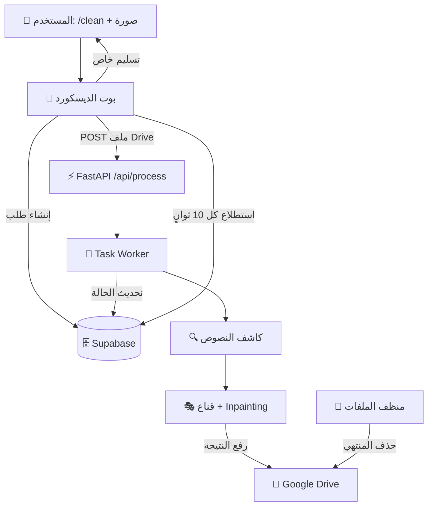
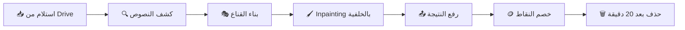
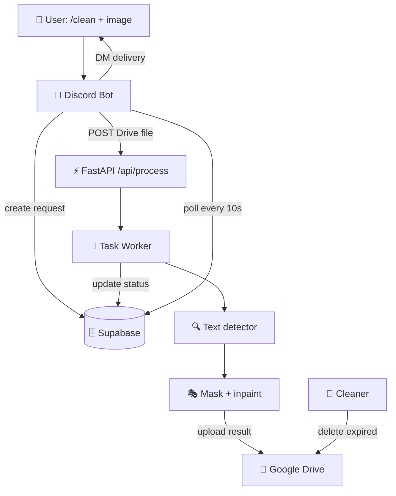

<div align="center">

# 🧹 CLEAN BOT

### منظف صفحات المانجا بالذكاء الاصطناعي — AI Manga Panel Cleaner

[](./LICENSE)
[](https://www.python.org/)
[](https://fastapi.tiangolo.com/)
[](https://pytorch.org/)
[](https://github.com/advimman/lama)
[](https://discord.js.org/)
[](https://supabase.com/)
[](https://www.docker.com/)

**بوت ديسكورد + سيرفر تنظيف صور المانجا (إزالة النصوص وترميم الخلفية) مع نظام نقاط وتخزين سحابي.**

**Discord bot + manga panel-cleaning server (text removal & inpainting) with credits and cloud storage.**

</div>

---

<div align="center">

## 🌍 اختار اللغة — Choose Language

### [🇪🇬 العربية](#-النسخة-العربية) &nbsp;&nbsp;|&nbsp;&nbsp; [🇬🇧 English](#-english-version)

</div>

---

<a id="-النسخة-العربية"></a>

<div dir="rtl">

## 🇪🇬 النسخة العربية

### 📖 الفكرة

**Clean Bot** منظومة متكاملة لتنظيف صفحات المانجا: المستخدم يبعت الصورة لبوت الديسكورد (`/clean`)، السيرفر (FastAPI) يكشف مناطق النصوص، يشيلها، ويرمم الخلفية بموديلات **LaMa** — والنتيجة ترجع خاص مع حذف تلقائي بعد 20 دقيقة. نظام نقاط واشتراكات عبر Supabase وتخزين Google Drive.

### 🏗️ المعمارية



### 🔄 خط التنظيف (Pipeline)



### ✨ المميزات

- 🤖 أوامر ديسكورد: `/clean` `/balance` `/profile` `/history` `/ping` + إدارة النقاط
- 🔍 4 كواشف نصوص + 5 موديلات ترميم للاختيار من قائمة تفاعلية
- 👁️ فحص تلقائي للطلبات المكتملة/الفاشلة كل 10 ثوانٍ
- 🗑️ انتهاء صلاحية تلقائي للملفات
- 🐳 دعم Docker (معالج + كارت شاشة) + نشر بسكربت واحد
- 📜 ملف `New Text Document.txt` فيه كل أوامر التشغيل مرتبة

### 🎨 جدول موديلات الترميم (LaMa)

| # | الموديل | الحجم | المميز |
|---|---|---|---|
| 1 | `anime-manga-big-lama` | 200MB | **الافتراضي** — مجرب للمانجا والأسرع |
| 2 | `big-lama` | 200MB | الكلاسيكي الأصلي الموثوق |
| 3 | `anime-manga-inpainting` | 205MB | نسخة dreMaz بصيغة ckpt |
| 4 | `anime-big-lama-hf` | 197MB | مرآة HuggingFace |
| 5 | `lama-manga` | 204MB | SafeTensors — الأكثر أماناً |

### 🔍 جدول كواشف النصوص

| # | الكاشف | السرعة/الحجم | الاستخدام |
|---|---|---|---|
| 1 | `hi-sam vit_h` | دقيق وبطيء — 632M ‏(~6GB VRAM) | أعلى جودة |
| 2 | `hi-sam vit_b` | سريع — 91M | **الأفضل للكروت الضعيفة** |
| 3 | `ComicTextDetector` | متوازن 88% — ‏0.05s | توازن عام |
| 4 | `YOLO11s` | **الأسرع 95.6% — ‏0.015s** | السرعة القصوى |

### 🛠️ جدول التقنيات

| المكون | التقنية | الدور |
|---|---|---|
| الواجهة | Discord.js v14 ‏(Node.js) | أوامر + إشعارات + استطلاع |
| السيرفر | FastAPI + Uvicorn ‏(Python) | API وتنسيق المهام |
| قاعدة البيانات | Supabase ‏(PostgreSQL) | نقاط + طلبات + سجل |
| الترميم | LaMa ‏(PyTorch + CUDA) | ملء الخلفيات |
| الكشف | Hi-SAM / CTD / YOLO11s | تحديد مناطق النصوص |
| الصور | OpenCV • Pillow • NumPy • scikit-image | معالجة ودمج |
| التخزين | Google Drive ‏(OAuth2) | دخل/خرج |
| الكاش | Redis | حالة المهام |

### ⌨️ أوامر الديسكورد

| الأمر | الوصف | الصلاحية |
|---|---|---|
| `/ping` | زمن الاستجابة | الجميع |
| `/balance [user]` | الرصيد | self ‏/ admin |
| `/profile [user]` | الملف والإحصائيات | self ‏/ admin |
| `/history [user]` | آخر العمليات | self ‏/ admin |
| `/clean` | تنظيف صورة/مجلد | الجميع |
| `/add_points` `/deduct` | إدارة النقاط | admin فقط |

### 🔌 نقاط الـ API (تحت `/api`)

| الطريقة | المسار | الوصف |
|---|---|---|
| GET | `/health` | حالة السيرفر |
| GET | `/ready` | الجاهزية |
| GET | `/device` | معلومات الجهاز/CUDA |
| POST | `/process` | بدء مهمة تنظيف |
| GET | `/status/{request_id}` | حالة الطلب |
| GET | `/settings/generate-key` | توليد مفتاح |

### 🚀 التشغيل (5 خطوات)

```bash
# 1. ثبّت الأساسيات
pip install torch torchvision --index-url https://download.pytorch.org/whl/cu128
pip install -r requirements.txt
cd discord-bot && npm i && cd ..

# 2. البيئة: انسخ .env.example إلى .env واملأ القيم
#    + حط credentials/google-service-account.json

# 3. شغّل (يكشف CUDA + قائمة تفاعلية للموديل والكاشف)
chmod +x start.sh stop.sh && ./start.sh

# 4. السيرفر على http://localhost:10100 والبوت يشتغل معه

# 5. النشر: .\sync_to_server.ps1 ثم ./start.sh على السيرفر
```

التفاصيل الكاملة في `New Text Document.txt`.

### 🗄️ قاعدة البيانات

| الجدول | الغرض |
|---|---|
| `users` | الحسابات والنقاط والاستهلاك |
| `requests` | الطلبات مع `notified` وتتبع الحالة |
| `transaction_log` | سجل النقاط |
| `settings` | رابط الديسكورد والإعدادات العامة |

### 📁 الهيكل

```
clean-bot/
├── app/
│   ├── api/main.py          # تطبيق FastAPI والنقاط
│   ├── workers/task_worker.py # منسق المهام
│   ├── services/            # cleanup • drive • inpainting • masker • models
│   └── server_config.py     # الإعدادات
├── discord-bot/index.js     # البوت والأوامر والاستطلاع
├── main.py                  # نقطة التشغيل
├── start.sh / stop.sh       # تشغيل وإيقاف
├── sync_to_server.ps1       # النشر على السيرفر
├── New Text Document.txt    # دفتر أوامر التشغيل
├── .env.example             # قالب المتغيرات
└── requirements.txt
```

<details>
<summary><b>🕰️ تاريخ المشروع</b></summary>

| المرحلة | التاريخ | الوصف |
|---|---|---|
| `v00` | 2026-07-11 | لقطة PanelCleaner الأصلية مع البوت والمستندات |
| `v01` | 2026-07-12 | إعداد السيرفر + pcleaner + docker + ملاحظات التشغيل |
| restructure | 2026-08-26 | إعادة هيكلة شاملة لسيرفر app مع سكربتات التشغيل والنشر |

</details>

</div>

---

<a id="-english-version"></a>

## 🇬🇧 English Version

### 📖 Overview

**Clean Bot** is a full manga panel-cleaning pipeline: users send pages to the Discord bot (`/clean`), the FastAPI server detects text regions, removes them and inpaints backgrounds with **LaMa** models — results delivered via DM with auto-delete after 20 minutes. Credits via Supabase, storage on Google Drive.

### 🏗️ Architecture



### 🔄 Cleaning Pipeline


### ✨ Features

- 🤖 Discord commands: `/clean` `/balance` `/profile` `/history` `/ping` + points admin
- 🔍 4 text detectors + 5 inpainting models via interactive menu
- 👁️ Auto-polling of completed/failed requests every 10s
- 🗑️ Automatic file expiry
- 🐳 Docker support (CPU + GPU) + one-script deploy
- 📜 `New Text Document.txt` runbook with every run command

### 🎨 Inpainting Model Matrix (LaMa)

| # | Model | Size | Highlight |
|---|---|---|---|
| 1 | `anime-manga-big-lama` | 200MB | **Default** — proven for manga, fastest |
| 2 | `big-lama` | 200MB | Original classic, reliable |
| 3 | `anime-manga-inpainting` | 205MB | dreMaz ckpt variant |
| 4 | `anime-big-lama-hf` | 197MB | HuggingFace mirror |
| 5 | `lama-manga` | 204MB | SafeTensors — safest format |

### 🔍 Text Detector Matrix

| # | Detector | Speed/Size | Use |
|---|---|---|---|
| 1 | `hi-sam vit_h` | Accurate but slow — 632M (~6GB VRAM) | Max quality |
| 2 | `hi-sam vit_b` | Fast — 91M | **Best for low VRAM** |
| 3 | `ComicTextDetector` | Balanced 88% — 0.05s | General balance |
| 4 | `YOLO11s` | **Fastest 95.6% — 0.015s** | Max speed |

### 🛠️ Stack Table

| Component | Tech | Role |
|---|---|---|
| Bot Interface | Discord.js v14 (Node.js) | Commands + notifications + polling |
| API Server | FastAPI + Uvicorn (Python) | API and task orchestration |
| Database | Supabase (PostgreSQL) | Credits + requests + log |
| Inpainting | LaMa (PyTorch + CUDA) | Background fill |
| Detection | Hi-SAM / CTD / YOLO11s | Text region detection |
| Imaging | OpenCV • Pillow • NumPy • scikit-image | Processing & merging |
| Storage | Google Drive (OAuth2) | Input/output |
| Cache | Redis | Task state |

### ⌨️ Discord Commands

| Command | Description | Access |
|---|---|---|
| `/ping` | Latency | Everyone |
| `/balance [user]` | Balance | Self; admin for others |
| `/profile [user]` | Profile & stats | Self; admin for others |
| `/history [user]` | Recent ops | Self; admin for others |
| `/clean` | Clean image/folder | Everyone |
| `/add_points` `/deduct` | Manage points | Admin only |

### 🔌 API Endpoints (under `/api`)

| Method | Path | Description |
|---|---|---|
| GET | `/health` | Server health |
| GET | `/ready` | Readiness |
| GET | `/device` | Device/CUDA info |
| POST | `/process` | Start cleaning job |
| GET | `/status/{request_id}` | Job status |
| GET | `/settings/generate-key` | Key generation |

### 🚀 Run (5 steps)

```bash
# 1. Install base
pip install torch torchvision --index-url https://download.pytorch.org/whl/cu128
pip install -r requirements.txt
cd discord-bot && npm i && cd ..

# 2. Env: copy .env.example to .env and fill values
#    + place credentials/google-service-account.json

# 3. Launch (CUDA detect + interactive model/detector menu)
chmod +x start.sh stop.sh && ./start.sh

# 4. API at http://localhost:10100, bot starts alongside

# 5. Deploy: .\sync_to_server.ps1 then ./start.sh on server
```

Full details in `New Text Document.txt`.

### 🗄️ Database

| Table | Purpose |
|---|---|
| `users` | Accounts, credits, usage |
| `requests` | Jobs with `notified` + status tracking |
| `transaction_log` | Points log |
| `settings` | Discord link + global settings |

### 📁 Structure

```
clean-bot/
├── app/
│   ├── api/main.py          # FastAPI app & endpoints
│   ├── workers/task_worker.py # Job orchestrator
│   ├── services/            # cleanup • drive • inpainting • masker • models
│   └── server_config.py     # Settings
├── discord-bot/index.js     # Bot, commands & poller
├── main.py                  # Entry point
├── start.sh / stop.sh       # Start & stop
├── sync_to_server.ps1       # Server deploy
├── New Text Document.txt    # Runbook
├── .env.example             # Env template
└── requirements.txt
```

<details>
<summary><b>🕰️ Project history</b></summary>

| Stage | Date | Description |
|---|---|---|
| `v00` | 2026-07-11 | Upstream PanelCleaner snapshot with bot and docs |
| `v01` | 2026-07-12 | Server setup with pcleaner, docker and run notes |
| restructure | 2026-08-26 | Full restructure to app server with run/deploy scripts |

</details>

---

<div align="center">

### [⬆️ back to top / العودة للأعلى](#-clean-bot)

MIT License.

</div>
